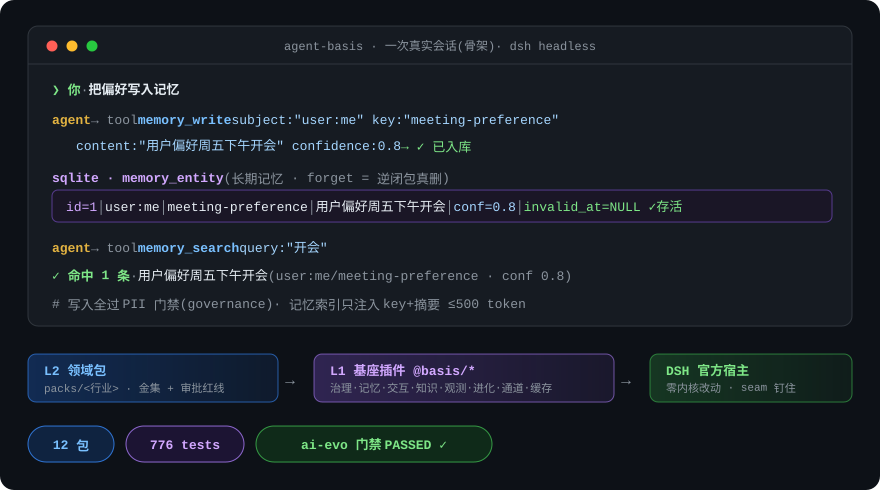

<div align="center">

# agent-basis

**领域 Agent 基座** —— 在 [DeepSeek Harness](https://github.com/deepseek-ai/deepseek-harness) 之上,把治理、记忆、人机交互、评测门禁、双向通道与受控自进化做成可复用插件;接入一个新行业,只需交付一份"领域包"。

[](https://github.com/mahingbun-dev/agent-basis/actions/workflows/ci.yml)
[](LICENSE)




</div>

**零内核改动。** 全部能力以 Cordis 插件承载(12 个包、2 个 CLI,776 个测试),seam 用 DSH 官方发布类型编译期钉住;官方内核升级不受牵连。

```text
L2 领域包(每行业一份)    packs/event-planning(@event/pack:30 条金集,含 3 条审批红线)
L1 基座插件(跨行业复用)
  governance   规则引擎(deny 优先 fail-closed)· 预算守卫 · PII · 审计 · egress
  memory       三层记忆;forget = 逆闭包真删,非打标
  interact     HITL 风险分档 R0-R3 · 富审批卡片 · 提问合并 · 审批负信号
  knowledge    本地 LLM wiki(FTS5 混检)↔ WeKnora 双后端 · 提案制写入 · 三层过期过滤
  observe      失败信号表 · token/成本/缓存命中率 · 漂移检测
  evolve       受控自进化:SKILL 条目化 delta · 进化账本 · G0/G1/G2 门禁 · prompt-audit
  channels     微信(三路径)/飞书/钉钉/邮箱 双向 · 一次性审批令牌(防重放)
  cache-guard  KV-cache 前缀稳定性守护(DeepSeek 缓存价差 ~50×)
  extra        egress 域名白名单 · reviewer preset · 多租户 realm
CLI: packctl(领域包脚手架/体检) · dsh-evals(评测 runner:replay / acp 双适配)
```

## 30 秒上手

```bash
pnpm install && pnpm run verify          # 12 包全绿(oxlint + tsc strict + vitest)

# 生成一个新行业的领域包骨架,并体检
node tools/packctl/bin/packctl.mjs init <行业名> --root packs
node tools/packctl/bin/packctl.mjs lint packs/<行业名>

# 回放适配器跑活动策划金集(无需模型凭据)
node tools/evals/bin/dsh-evals.mjs run --pack packs/event-planning --adapter replay
# → 20/20 通过,3 条审批红线全部正确拦截(预算超支必须触发审批/付款必须升级/比选必须中立)

# CI 里触发 ai-evo 平台门禁并等结果(官方 aievo-cli 的零依赖等价封装,退出码 0=passed/1=failed/2=error)
node tools/aievo-run.mjs run task_e7cedc05e36c --wait --timeout 1800 --json
```

## 为什么是它

| | 常见做法 | agent-basis |
|---|---|---|
| 内核 | 直接在框架里写业务,升级即重构 | **零内核改动**,插件装卸可逆(effect 配逆闭包) |
| 质量保障 | 上线前人工看几眼 | **评测即门禁**:终态断言 + 轨迹匹配 + 阈值卡发布 |
| 行业接入 | 重写一遍 prompt 与流程 | **领域包**:persona + skills + 工具 + policies + evals,验收 = 该包评测通过率 |
| 持续改进 | 手工调提示词 | **受控自进化**:无外部信号不进化、只许增量 delta、晋升必过防作弊门禁 |

自进化机制有论文锚点:ACE([arXiv:2510.04618](https://arxiv.org/abs/2510.04618))、LLMs Cannot Self-Correct Yet([arXiv:2310.01798](https://arxiv.org/abs/2310.01798))、Darwin Gödel Machine([arXiv:2505.22954](https://arxiv.org/abs/2505.22954))。

## 第一个领域包:@event(活动策划)

[packs/event-planning](packs/event-planning) 是完整的参考实现:30 条黄金任务(策划案/预算/比选/排期/风险/复盘 × 审批红线)、条目化 SKILL.md、hitl.yaml 风险分档、ai-evo 平台导出。**复制这个目录,就是接入下一个行业的起点。**

## 文档

| 文档 | 内容 |
|---|---|
| [docs/design/](docs/design/) | 设计文档 15 篇:业界调研、架构、RSI 自进化、知识插件、功能点清单 |
| [docs/ai-evo-integration.md](docs/ai-evo-integration.md) | 评测平台(ai-evo)对接:门禁任务 / 数据集 / 阈值 |
| [packs/event-planning/evals/](packs/event-planning/evals/) | 金集格式与终态/轨迹断言写法 |

## License

[MIT](LICENSE)
