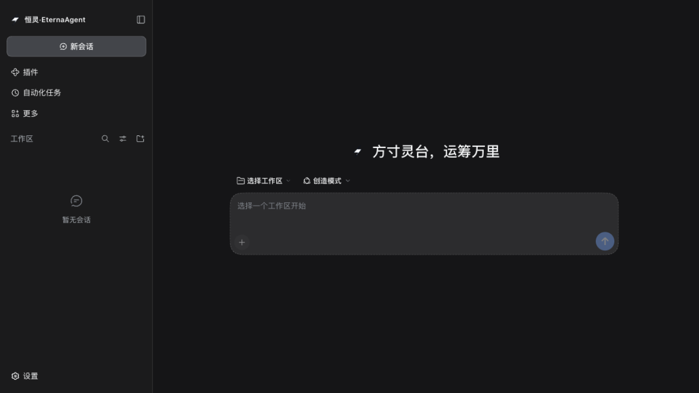
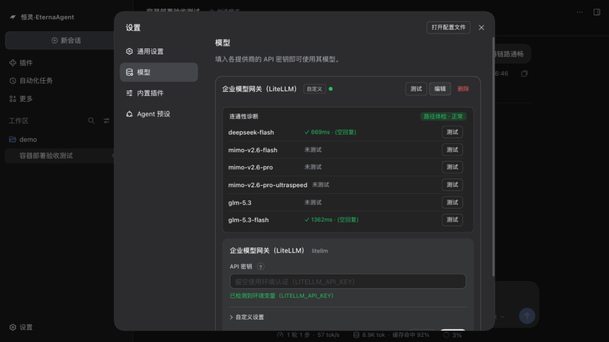

<div align="center">

# EternaAgent

**An enterprise agent platform built on [DeepSeek Harness](https://github.com/deepseek-ai/deepseek-harness): policy governance, HITL approvals, memory, knowledge, eval-gated self-evolution, and one-command Docker deploy — all as reversible plugins, zero kernel changes.**

[](https://github.com/mahingbun-dev/agent-basis/actions/workflows/ci.yml)
[](https://github.com/mahingbun-dev/agent-basis/releases)
[](LICENSE)




[中文文档](README.zh-CN.md)

</div>

Repo codename: `agent-basis` (historical). Product name: **EternaAgent** (恒灵). Everything below is what ships in this repo today.

## What you get

```text
L2 industry packs (one per industry)   packs/event-planning (@event: 30 golden tasks, 3 approval red lines)
                                       packs/industrial-analysis (@industrial: motor-vibration QA, shift reports)
L1 base plugins (cross-industry)
  governance    rule engine (deny wins, fail-closed) · budget guard · PII · egress control
  audit         append-only audit trail (daily jsonl sink) + query API
  memory        three-layer memory; forget = true reverse-closure delete, not a flag
  interact      HITL risk tiers R0–R3 · rich approval cards · question merging · negative signals
  knowledge     local LLM wiki (FTS5 hybrid search) ↔ WeKnora dual backend · proposal-based writes
  observe       failure-signal table · token/cost/cache-hit metrics · drift detection
  evolve        gated self-evolution: SKILL-ified deltas · evolution ledger · G0/G1/G2 gates
  channels      WeChat (three routes) / Feishu / DingTalk / email, bidirectional · one-time approval tokens
  cache-guard   KV-cache prefix stability guard (DeepSeek cache price gap ~50×)
  extra         egress domain whitelist · reviewer preset · multi-tenant realm isolation
  llm-doctor    LLM connectivity doctor: protocol-aware path probes + per-model real tests
  panel         web console for memory / governance / audit state
  prompt-studio system-prompt workspace with version store and run-state traces
  brand         product branding layer (logo/title/favicon/locale overrides)
  llm-openai    OpenAI-compatible adapter for embed-grade headless hosts

CLI: packctl (industry-pack scaffold & lint) · dsh-evals (eval runner: replay / acp adapters) · eterna-smoke
```

**Zero kernel changes.** Everything is a Cordis plugin on the stock DSH runtime; seams are pinned at compile time against officially published DSH types, so kernel upgrades don't drag your code along.

## Quick start

Prerequisites: Node ≥ 22 and pnpm ≥ 10 (`corepack enable`). No model credentials needed for the test suite.

```bash
pnpm install
pnpm run verify        # 19 packages: oxlint + tsc strict + vitest → all green (1000 tests)

# Scaffold a new industry pack, then lint it
node tools/packctl/bin/packctl.mjs init <industry> --root packs
node tools/packctl/bin/packctl.mjs lint packs/<industry>

# Replay the event-planning golden set offline (no model credentials required)
node tools/evals/bin/dsh-evals.mjs run --pack packs/event-planning --adapter replay
# → total=30 pass=30 fail=0 (100%) — all 3 approval red lines intercepted correctly
```

## Deploy with Docker

```bash
cp .env.example .env    # set LITELLM_API_KEY (any OpenAI-compatible gateway; LiteLLM works out of the box)
docker compose up -d --build
docker compose logs eterna-agent | grep token   # one-time bootstrap token
# → open http://localhost:3210/?token=<token>
```

What you get is the full web agent: the model settings page with a full editor (base URL / protocol / model catalog / per-model connectivity tests), the diagnostics panel, policy governance, and audit trails persisted in a named volume. Reverse-proxy parameters (`ETERNA_PUBLIC_URL` / `ETERNA_TRUSTED_HOST`) are env-only — see [docs/docker-deploy.md](docs/docker-deploy.md).



## Why EternaAgent

| | Typical approach | EternaAgent |
|---|---|---|
| Kernel coupling | build on the framework, refactor on every upgrade | **zero kernel changes**; plugins attach/detach reversibly (effects unwind via inverse closures) |
| Quality assurance | eyeball it before release | **evals as a gate**: terminal-state assertions + trajectory matching + thresholds block the release |
| New industry | rewrite prompts and flows | **industry pack**: persona + skills + tools + policies + evals; acceptance = that pack's eval pass rate |
| Continuous improvement | hand-tune prompts | **gated self-evolution**: no external signal, no evolution; deltas only; promotion must pass anti-cheating gates |

The self-evolution design has academic anchors: ACE ([arXiv:2510.04618](https://arxiv.org/abs/2510.04618)), LLMs Cannot Self-Correct Yet ([arXiv:2310.01798](https://arxiv.org/abs/2310.01798)), Darwin Gödel Machine ([arXiv:2505.22954](https://arxiv.org/abs/2505.22954)).

## First industry pack: @event

[packs/event-planning](packs/event-planning) is the complete reference implementation: 30 golden tasks (plans / budgets / vendor comparisons / schedules / risks / retrospectives × approval red lines), itemized SKILL.md, hitl.yaml risk tiers, ai-evo platform export. **Copy this directory to onboard the next industry.**

## Scope & limitations

- Runs on the stock DeepSeek Harness runtime (npm `@deepseek-ai/dsh`, version-pinned); upstream upgrades go through [docs/upgrade-gate.md](docs/upgrade-gate.md) before adoption.
- Model routing targets OpenAI-compatible gateways (LiteLLM recommended); DeepSeek direct/account routes are disabled by default (compliance: keys stay in your env/gateway, never in the harness).
- The governance/red-line packs are reference implementations for two industries; a new industry means authoring a new pack (scaffold provided).
- Public exposure over home broadband is IPv6-only unless you add a relay — see the reverse-proxy notes in [docs/docker-deploy.md](docs/docker-deploy.md).

## Documentation

| Document | Contents |
|---|---|
| [docs/USER-GUIDE.md](docs/USER-GUIDE.md) | **User guide**: every feature's trigger example, how to run evals/gates, how to install plugins from the index (index URL: `https://raw.githubusercontent.com/mahingbun-dev/agent-basis/main/market/index.json`) |
| [docs/PLUGIN-AUTHORING.md](docs/PLUGIN-AUTHORING.md) | Plugin authoring guide (creation mode, local dev → in-repo, hard rules & mounting recipes) |
| [docs/eterna-plugin-mapping.md](docs/eterna-plugin-mapping.md) | Plugin naming map: eterna ids ↔ upstream DSH source paths, merge playbook, non-renamable official ids |
| [docs/docker-deploy.md](docs/docker-deploy.md) | Container deploy: env matrix, reverse-proxy handoff, volume layout |
| [docs/design/](docs/design/) | Design docs: research, architecture, RSI self-evolution, knowledge plugin |
| [docs/upgrade-gate.md](docs/upgrade-gate.md) | Upstream version upgrade gate (four-step local + CI cross-check) |
| [packs/event-planning/evals/](packs/event-planning/evals/) | Golden-set format: terminal-state & trajectory assertion cookbook |

## License

[MIT](LICENSE)
