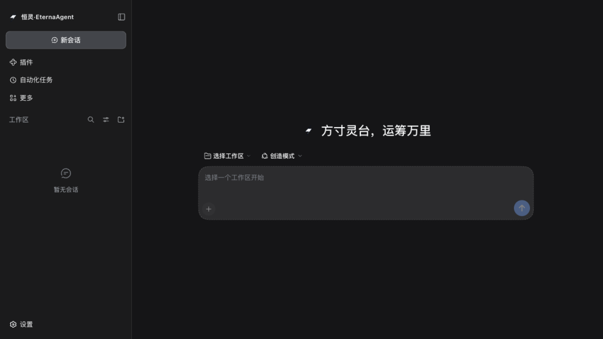
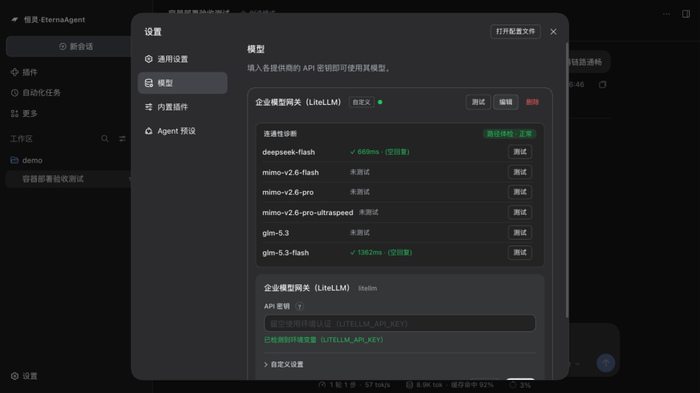

<div align="center">

# 恒灵·EternaAgent

**构建于 [DeepSeek Harness](https://github.com/deepseek-ai/deepseek-harness) 之上的企业级 Agent 平台:策略治理、HITL 审批、记忆、知识、评测门禁式受控自进化、一条命令的 Docker 部署——全部以可逆插件承载,零内核改动。**

[](https://github.com/mahingbun-dev/agent-basis/actions/workflows/ci.yml)
[](https://github.com/mahingbun-dev/agent-basis/releases)
[](LICENSE)




[English](README.md)

</div>

仓库代号 `agent-basis`,产品名 **EternaAgent(恒灵)**。本文件所述即仓库当前真实交付物。

## 你能得到什么

```text
L2 领域包(每行业一份)     packs/event-planning(@event:30 条金集,含 3 条审批红线)
                          packs/industrial-analysis(@industrial:电机振动问答/交接班报告)
L1 基座插件(跨行业复用)
  governance    规则引擎(deny 优先 fail-closed)· 预算守卫 · PII · egress 出网控制
  audit         审计留痕(按日 jsonl sink)+ 查询 API
  memory        三层记忆;forget = 逆闭包真删,非打标
  interact      HITL 风险分档 R0-R3 · 富审批卡片 · 提问合并 · 审批负信号
  knowledge     本地 LLM wiki(FTS5 混检)↔ WeKnora 双后端 · 提案制写入
  observe       失败信号表 · token/成本/缓存命中率 · 漂移检测
  evolve        受控自进化:SKILL 条目化 delta · 进化账本 · G0/G1/G2 门禁
  channels      微信(三路径)/飞书/钉钉/邮箱 双向 · 一次性审批令牌(防重放)
  cache-guard   KV-cache 前缀稳定性守护(DeepSeek 缓存价差 ~50×)
  extra         egress 域名白名单 · reviewer preset · 多租户 realm 隔离
  llm-doctor    LLM 连通性诊断:协议感知路径体检 + 逐模型真测
  panel         记忆/治理/审计状态的 Web 控制台
  prompt-studio system prompt 工作室(版本库 + 运行态轨迹)
  brand         产品品牌层(logo/标题/favicon/locale 替换面)
  llm-openai    OpenAI 兼容适配器(embed 档无头宿主)
  access        账号门禁:管理员管用户、登录桥接、用户自助资料页、租户守卫工作区隔离

CLI: packctl(领域包脚手架/体检) · dsh-evals(评测 runner:replay / acp 双适配) · eterna-smoke
```

**零内核改动。** 全部能力以 Cordis 插件承载于原版 DSH 运行时;seam 用 DSH 官方发布类型编译期钉住,官方内核升级不牵连业务代码。

## 30 秒上手

前置:Node ≥ 22、pnpm ≥ 10(`corepack enable`)。测试套件不需要模型凭据。

```bash
pnpm install
pnpm run verify        # 20 包:oxlint + tsc strict + vitest → 全绿(1076 测试)

# 生成一个新行业的领域包骨架,并体检
node tools/packctl/bin/packctl.mjs init <行业名> --root packs
node tools/packctl/bin/packctl.mjs lint packs/<行业名>

# 回放活动策划金集(无需模型凭据)
node tools/evals/bin/dsh-evals.mjs run --pack packs/event-planning --adapter replay
# → total=30 pass=30 fail=0(100%),3 条审批红线全部正确拦截
```

## Docker 部署

```bash
cp .env.example .env    # 填 LITELLM_API_KEY + 管理员账号(ETERNA_ACCESS_ADMIN_USER/PASSWORD,首启播种)
docker compose up -d --build
# → 打开 http://localhost:3210/login 用管理员账号登录——无需 token
```

得到账号门禁后的完整 Web Agent:管理员管用户(不开放注册,重名自动加数字后缀),每个用户有自助资料页(昵称/头像/密码),登录自动桥接 dsh 会话;工作区按账号租户隔离(采纳/浏览/建会话钳制在各自家目录),admin 可实例级停启 L1 插件(红线锁定)。满血模型设置页(Base URL/协议/模型目录/逐模型连通测试)、诊断面板、策略治理、审计留痕(named volume 持久化)。反代参数(`ETERNA_PUBLIC_URL` / `ETERNA_TRUSTED_HOST` / `ETERNA_ACCESS_SECURE`)纯 env——见 [docs/docker-deploy.md](docs/docker-deploy.md)。



## 为什么是它

| | 常见做法 | EternaAgent |
|---|---|---|
| 内核耦合 | 在框架里写业务,升级即重构 | **零内核改动**,插件装卸可逆(effect 配逆闭包) |
| 质量保障 | 上线前人工看几眼 | **评测即门禁**:终态断言 + 轨迹匹配 + 阈值卡发布 |
| 行业接入 | 重写一遍 prompt 与流程 | **领域包**:persona + skills + 工具 + policies + evals,验收 = 该包评测通过率 |
| 持续改进 | 手工调提示词 | **受控自进化**:无外部信号不进化、只许增量 delta、晋升必过防作弊门禁 |

自进化机制有论文锚点:ACE([arXiv:2510.04618](https://arxiv.org/abs/2510.04618))、LLMs Cannot Self-Correct Yet([arXiv:2310.01798](https://arxiv.org/abs/2310.01798))、Darwin Gödel Machine([arXiv:2505.22954](https://arxiv.org/abs/2505.22954))。

## 第一个领域包:@event(活动策划)

[packs/event-planning](packs/event-planning) 是完整的参考实现:30 条黄金任务(策划案/预算/比选/排期/风险/复盘 × 审批红线)、条目化 SKILL.md、hitl.yaml 风险分档、ai-evo 平台导出。**复制这个目录,就是接入下一个行业的起点。**

## 边界与前提

- 运行于原版 DeepSeek Harness 内核(npm `@deepseek-ai/dsh`,钉版);上游升版须经 [docs/upgrade-gate.md](docs/upgrade-gate.md) 门禁裁决后才采纳。
- 模型路由面向 OpenAI 兼容网关(推荐 LiteLLM);DeepSeek 直连/账号路由默认裁切(合规红线:密钥只在你自己的 env/网关,不落 harness)。
- 治理红线包是两个行业的参考实现;新行业 = 编写新领域包(脚手架已提供)。
- 家宽环境公网暴露仅 IPv6 可达(除非加中继)——见 [docs/docker-deploy.md](docs/docker-deploy.md) 反代说明。

## 文档

| 文档 | 内容 |
| --- | --- |
| [docs/USER-GUIDE.md](docs/USER-GUIDE.md) | **用户指南(装完即会用)**:全部功能触发示例、评测/门禁怎么跑、插件怎么从索引安装(索引 URL:`https://raw.githubusercontent.com/mahingbun-dev/agent-basis/main/market/index.json`) |
| [docs/PLUGIN-AUTHORING.md](docs/PLUGIN-AUTHORING.md) | 插件开发指南(创造模式/本地开发 → 入库,含硬性规范与装载配方) |
| [docs/eterna-plugin-mapping.md](docs/eterna-plugin-mapping.md) | 插件命名映射:eterna id ↔ 上游 DSH 源仓路径、合并姿势、不可改名官方 id 清单 |
| [docs/docker-deploy.md](docs/docker-deploy.md) | 容器部署:env 矩阵、反代衔接、卷布局 |
| [docs/design/](docs/design/) | 设计文档:业界调研、架构、RSI 自进化、知识插件 |
| [docs/upgrade-gate.md](docs/upgrade-gate.md) | 上游版本升级门禁(本地四步 + CI 互证) |
| [packs/event-planning/evals/](packs/event-planning/evals/) | 金集格式:终态/轨迹断言写法 |

## License

[MIT](LICENSE)
