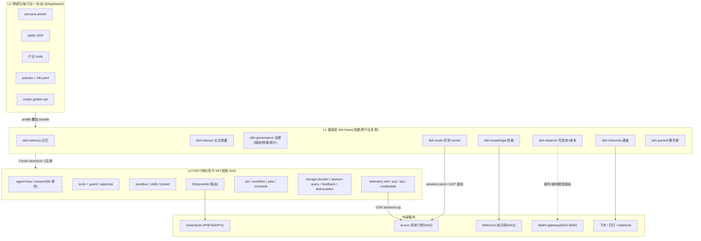
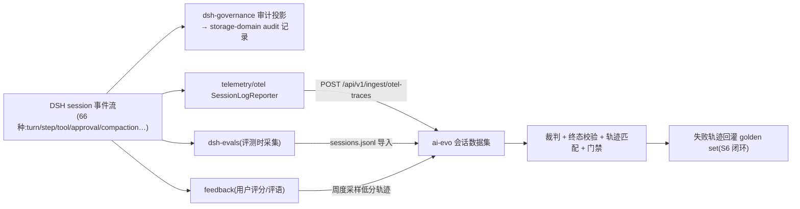
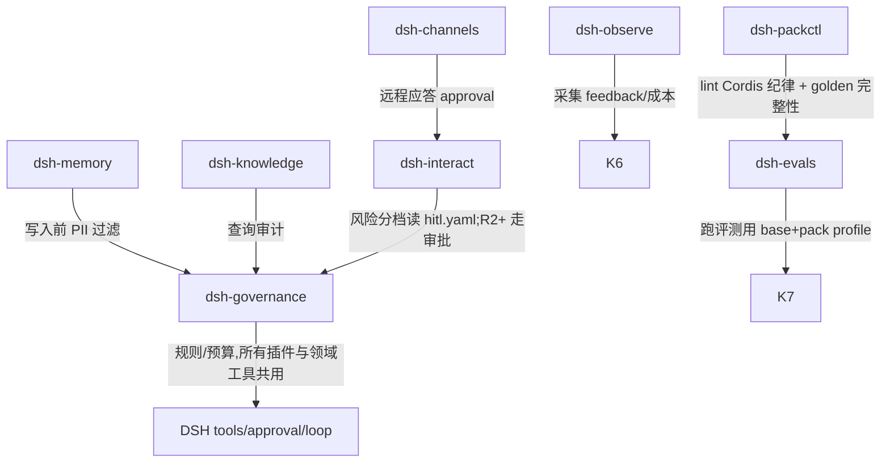

# 08 - 基座插件体系与总体架构(v0.1)

> 状态:设计稿,待评审。目标:定义在 DSH 之上,L1 基座层要开发哪些插件、每个插件站在 DSH 哪个机制上、旗舰插件(记忆 / 人机交互)的详细设计。依据:[[04-DSH源码设计笔记]](机制与文件证据,含本轮补充的 storage/feedback/deliverables/schedule/jobs/acp/api/credentials 等包调研)、[[05-Cordis论文研读笔记]](插件纪律)、[[06-行业Agent开发SOP-草案v0.1]]、[[07-评测体系-ai-evo对接与本地eval插件]]。

## 1. 设计原则

1. **不重复造轮子**:L1 只做 DSH 缺失或行业必需的部分。本轮补充调研确认 DSH 已自带:storage-domain(持久化+变更通知)、feedback(会话评语+逐条消息评分)、deliverables(present 工具+逐 turn 文件变更记录)、schedule(RFC 5545 定时任务)、jobs(后台作业)、plan(计划模式)、session-query(历史会话全文检索)、acp(编程化驱动 agent + 远程应答审批)、api/gateway(Client↔Host 能力调用)、credentials(凭据引用,secret 不进配置)、settings(插件配置表单)、document(Office→PDF)。**这些全部直接消费,不重建**。
2. **投资"组织向"部件**:权限治理、审批、审计、评测、通道、记忆的**策略层**——模型进步不会吸收的部分(业界调研结论)。
3. **Cordis 三纪律**(所有 L1/L2 插件):effect 配逆闭包;coeffect 全声明(不碰旁路全局);provide 可交换接口(注册表+唯一 ID,`@eterna/*`、`@<industry>/*` 命名空间)。
4. **每个插件自带验收**:插件的能力用 golden cases 定义(进 ai-evo),插件本身就是被测对象。

## 2. 总体架构图

**会话事件主数据流**(一切可观测/审计/评测的源头都是 session 事件流):

## 3. L1 插件清单

| # | 插件 | 职责 | 站在 DSH 哪个机制上 | 优先级 |
|---|---|---|---|---|
| 1 | **dsh-governance** | 细粒度 allow/deny/ask 规则(按 pack 声明,fail-closed,deny 不可绕过);turn/token/cost 预算守卫;审计投影 | `tools/pre-execute` waterfall、`ctx.tools.guard()`、`agent/turn-stopping`、session 事件→storage-domain | **P0** |
| 2 | **dsh-memory** | 三层记忆(见 §5) | `ctx.tools` 注册 memory 工具、storage-domain(typed records+变更通知)、session-query(全文检索)、system-prompt section 注入、schedule(整固) | **P0** |
| 3 | **dsh-interact** | 交互质量(见 §6) | `ctx.approval` answerer waterfall、`ask_user_question`、plan、todo/goal、deliverables、feedback、web UI renderer | **P0** |
| 4 | **dsh-evals** | 本地评测 runner(设计见 07) | Python SDK / acp 驱动 session;输出对齐 ai-evo | **P0** |
| 5 | **dsh-packctl** | 领域包脚手架与**无代码工作台**:`pack init/lint/check`(结构校验、Cordis 纪律 lint、golden set 完整性检查);Web/Obsidian 内容管理界面(业务专家不改代码增删改 L2);**对话式添加**(agent 生成 persona/skill/knowledge 提案→审批→发布,与 interact/evolve 提案制共用) | bundle/profile 规范、settings、client UI 插件机制 | **P0**(CLI 部分)/P1(工作台 UI) |
| 6 | **dsh-knowledge** | 企业知识检索工具 `knowledge_search`(带引用出处) | `ctx.tools` + WeKnora API;评测走 ai-evo RAG 检索评测类型 | **P1** |
| 7 | **dsh-observe** | OTel→ai-evo 直通;成本/缓存命中率报表(token 计量来自 request/context 事件);feedback→eval 回灌队列 | telemetry/otel、feedback、storage | **P1** |
| 8 | **dsh-channels** | **全渠道双向通讯**:webhook 入站;**微信三路径**(腾讯微信团队官方维护插件[QR 登录个人微信]/企微智能机器人 API 模式/微信客服 API)+飞书/钉钉 收发+远程审批应答(人不在电脑前也能批);**邮箱通道**(IMAP 收件触发+SMTP 回复,审批走一次性令牌防伪造);渠道 user↔session 绑定续接 | acp(API server 可应答 permission prompt)、api/gateway、schedule、storage-domain(绑定关系) | **P1**(微信/企微/邮箱与飞书同期) |
| 9 | dsh-cache-guard | 前缀稳定性守护(启动/运行时告警破坏 KV-cache 的行为)+ 命中率采集 | request/header 事件、llm seam | P1 |
| 10 | dsh-egress | 网络出口白名单(补沙箱不管网络的缺口) | 包裹 shell/web 类工具执行 | P2 |
| 11 | dsh-evolve | **受控自进化引擎(RSI,设计见 [[09-RSI自进化机制设计]])**:六阶段循环(信号→反思→提案→验证→发布→废弃);reflector job、ACE 条目化 delta 提案、supersession 废弃、进化账本 | dsh-observe 信号、schedule/jobs 调度、dsh-evals+ai-evo 门禁、storage-domain 账本、pack 版本化 | **P1**(Phase 1 人工环随 P0 起步) |
| 12 | dsh-reviewer | 只读审查 subagent preset(工具白名单:Read/Grep/Glob),供领域包"verify work"步使用 | subagent preset、persona | P2 |
| 13 | dsh-tenant | 多租户 realm 规范与隔离(行业→客户两级) | Cordis isolate realm、credentials | P2 |

> 注:dsh-memory §5.4 的整固 job 自 09 起归入 dsh-evolve reflector 触发源(memory 负责写入与遗忘的执行,dsh-evolve 负责反思与提案的编排)。

**明确不建**(DSH 已有,直接消费):workflow 编排、schedule 定时、jobs 后台作业、plan 模式、deliverables、document(Office→PDF,行业产出物直接可用)、attachment、credentials、settings、ACP/API/SDK、storage 后端。

## 4. L1 插件间的依赖关系

原则:**governance 是所有 L1/L2 插件的公共 coeffect**(注入 `ctx.governance` service);任何插件不得旁路它直接触网/写外部系统。

## 5. 旗舰设计 ①:dsh-memory 记忆机制

**目标**:跨会话记住"该记的",忘掉"该忘的",全程可审计可回收。依据业界双重验证的"文件系统即记忆"模式(Manus/Anthropic)+ DSH 现成件。

### 5.1 三层记忆模型

| 层 | 内容 | 载体 | 生命周期 |
|---|---|---|---|
| M0 会话内 | 当前任务上下文 | DSH session log + compaction(内核已管,不建) | 会话 |
| M1 项目记忆 | 工作区事实:NOTES.md、TODO、领域中间产物、带路径引用的事实 | **workspace 文件即记忆**(agent 用 fs 工具直接读写;压缩可逆:留引用丢正文) | 项目目录 |
| M2 实体记忆 | 结构化长期事实:用户偏好、组织约定、历史案例结论、行业实体关系 | **storage-domain typed records**(schema 校验+变更通知;天然可审计) | 永久,可遗忘 |

**与 WeKnora 的边界(关键决策)**:企业**权威知识**(制度、手册、案例库,共享且版本化)→ `dsh-knowledge`(检索,不落本地);**经验性记忆**(这个用户偏好什么、这个客户上次争议点是什么,私有且增量)→ `dsh-memory`。两者不互写。

### 5.2 模型面工具(注册进 ctx.tools)

- `memory_write(key, content, scope: project|user|org, ttl?)`——写 M1/M2;**返回逆闭包**(Cordis effect 配逆;`memory_forget` = 应用逆,真删除而非打标)
- `memory_search(query, scope?)`——M1 全文(session-query)+ M2 记录过滤(storage-domain 查询),返回带出处
- `memory_read(key)` / `memory_list(scope)`
- 写入前强制过 governance 的 PII/敏感信息过滤器;`scope=org` 的写入**默认触发审批**(interact R2 档,因为它影响其他会话)

### 5.3 注入策略(渐进披露,不吃上下文)

- 会话启动时,system-prompt section 只注入**记忆索引**(M2 记录的 key+一句话摘要,预算 ≤500 token);
- 正文按需 `memory_read`——与 DSH skills 的"frontmatter 常驻、body 按需"同构。

### 5.4 整固(consolidation,记忆质量的关键)

- 会话结束(或 schedule 周期触发)起一个 **job**:用小模型从 session log 抽取"值得持久的候选事实"(含出处事件引用)→ 生成记忆提案;
- 提案分级:`scope=project` 静默写入;`scope=user/org` 走 interact 审批卡片("从本次会话学到:…,是否记住?");
- 重复/冲突记忆做合并与置信度衰减——**记忆膨胀是反模式**,整固 job 同时负责淘汰(淘汰也是 effect,可逆可审计)。

### 5.5 验收(golden cases 进 ai-evo)

跨会话记忆保持率(首会话告知偏好→隔 N 轮新会话验证应用)、遗忘正确性(forget 后检索不到)、PII 拦截率、注入预算不超标。

## 6. 旗舰设计 ②:dsh-interact 人机交互质量

**目标**:让"打扰"变少且每一次打扰都值得;让审批快、让交付清楚、让反馈有回路。核心洞察:**交互质量的本质是风险分档**——不是所有动作都值得问。

### 6.1 风险分档(由领域包 hitl.yaml 声明,governance 执行)

| 档 | 定义 | 默认策略 | 交互形态 |
|---|---|---|---|
| R0 只读 | 检索、读文件、查询 | 静默执行 | 无 |
| R1 可逆写 | 工作区内写文件、打草稿 | 静默执行 + **事后变更卡片**(deliverables 已有逐 turn diff,直接复用) | 无打断,事后可见 |
| R2 需确认 | 不可逆动作、对外发射(发消息/提交外部系统)、org 级记忆写入 | 审批卡片 | **富上下文审批**(见 6.2) |
| R3 高危 | 资金、法务效力、批量外发 | 审批 + 升级到指定人 + 二次确认;hitl.yaml 可配冷静期 | 卡片 + 强制摘要人复核 |

分档依据业界共识:OpenAI 指南的"高风险/失败阈值两触发器"+ 12-factor "HITL 即工具调用" + Claude Code "强制规则进 hook 不进 prompt"。

### 6.2 富上下文审批卡片(质量核心)

拦截 `approval/request` waterfall,把裸的"是否允许执行 X?"升级为结构化卡片:
- **将发生什么**:具体命令/调用的行业 API 与参数(超长折叠)
- **为什么**:触发它的 SOP 条目/skill 名、关联的 golden case
- **影响面**:涉及文件(带 diff 预览,deliverables 能力)、外部系统对象
- **回滚方式**:effect 的逆闭包是否存在;不可逆则明示"不可逆"
- **风险档与依据**:R2/R3 + hitl.yaml 哪条规则命中
- 卡片渲染:Web UI ConversationNodeDefinition(桌面)+ 飞书/钉钉卡片(channels,远程应答走 acp 的 permission prompt 通道)

### 6.3 提问与打扰治理

- **合并提问**:一次 turn 内多个 `ask_user_question` 合并为一张多问题卡片(上限 3 问),禁止"挤牙膏式"逐个问;
- **计划先行**:R2+ 动作占比高的任务,interact 建议进入 plan 模式(DSH 已有),计划批准后批量执行、只在偏差处打断;
- **无人值守降级**:acp 自动化场景下 ask 不可达时,按 hitl.yaml 的 `on_no_answer` 策略挂起(任务暂停非失败,approval 事件已持久,replay 即恢复)或超时升级 channels;
- **进度叙述**:todo/goal 里程碑 + jobs 完成通知 → 通道卡片,长任务不让用户"黑盒等待"。

### 6.4 反馈闭环(把用户的手势变成评测资产)

- 消费 DSH feedback(逐条消息评分 + 会话评语):低分消息轨迹自动进入 dsh-observe 的回灌队列 → 周度推 ai-evo 会话数据集 → 人工评审 → 修复沉淀回 golden set(S6);
- **交互质量本身的验收指标**:千 turn 打断率(R2+ 审批次数/完成 turn 数)、审批平均响应时长、误打扰率(批准后未发生负面后果的占比)、question 合并率——进 ai-evo 统计。

## 7. 开发路线(与 SOP 阶段对齐)

| 阶段 | 交付 | DoD |
|---|---|---|
| **P0(随 S0-S2)** | dsh-evals 最小版;governance v0(turn budget + allow/deny/ask 规则 + 审计投影);packctl `pack init/lint`;memory v0(M1 文件记忆 + memory_write/search + 注入索引);interact v0(风险分档 + R2 富审批卡片) | 20 条 golden 内环 <10min;卸载 bundle 无残留;审批事件可 replay;跨会话记忆 golden 通过 |
| **P1(随 S4-S5)** | knowledge(WeKnora);observe(OTel→ai-evo + 成本/缓存报表 + feedback 回灌);channels(webhook + 飞书远程审批);cache-guard;memory v1(M2 storage 整固 job) | OTel 三形态 ingest 通;门禁演练通过;缓存命中率报表可用;整固提案审批闭环 |
| **P2(上线后)** | egress 白名单;reviewer preset;tenant realm 规范 | 红队评测通过(egress);多租户隔离验证 |

## 8. 风险与开放问题

1. DSH pre-stable API:governance/memory 挂在 `tools/pre-execute`、`approval` waterfall、storage-domain 上,升级时跟随 `docs/upgrade-guide/` 迁移——**所有 L1 插件的适配面要在 CI 里用接口冒烟测试钉住**。
2. memory 整固 job 用哪个模型抽取(Flash 即可,但抽取质量决定记忆质量——golden 里要有整固质量用例)。
3. 审批卡片的飞书形态依赖 channels(P1)——P0 期间 R2 交互只在 Web/CLI,行业试点若强依赖 IM 需调 P1 顺序。
4. egress(P2)之前,行业工具插件调外部 API 不受网络白名单约束——试点期用"凭据最小化 + governance 规则限制工具清单"替代防御。
5. interact 的误打扰率指标需要基线数据——S5 灰度期采集。
