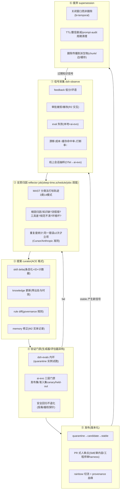

# 09 - RSI 自进化机制设计(受控自进化)

> 状态:设计稿,本次设计的核心闭环。回答四个需求:**不断学习、反思、自我进化;及时发现错误;改正错误、学习新方案;抛弃过时/废弃知识且不影响 agent**。
> 论文依据全部锚定一手文献(PDF 已入库 [[papers/00-RSI论文索引]]),业界对照来自一线公司工程实践(Fin/Harvey/Cursor/Devin/Sierra/Glean/Anthropic,2026-11 调研)。

## 0. 一句话定位

**RSI 不是"让 agent 运行时自由改自己",而是"把进化做成一条有门禁的发布流水线"**:信号采集 → 反思归因 → 提案(delta)→ 验证(评测门禁)→ 发布(版本化)→ 废弃(supersession)。agent 拥有提案权,评测门禁与人类拥有否决权,废弃靠状态迁移而非删除。

这个定位来自三条实证铁律,先立后动:

| # | 铁律 | 论文证据 |
|---|---|---|
| 1 | **无外部验证信号,不得触发进化更新。** 无外部反馈的 intrinsic self-correction 在推理任务上不升反降 | [[papers/2310.01798-llms-cannot-self-correct-yet.pdf\|LLMs Cannot Self-Correct Yet]](ICLR 2024);ACE 作者自认:无可靠反馈时与基线一样吸收伪信号 |
| 2 | **只许增量 delta,禁止单体重写。** 单体 prompt/context 的自我重写会 context collapse(18,282 token/66.7 分 → 坍缩到 122 token/57.1 分,低于不适应基线) | [[papers/2510.04618-ace-agentic-context-engineering.pdf\|ACE]](ICLR 2026)实测 |
| 3 | **晋升必过防作弊门禁;评估器与生成器异构且设不可修改区。** null model 都能骗过高分;自我修改循环会 reward hacking;评估器被改则一切失效 | [[papers/2410.07137-cheating-llm-benchmarks.pdf\|Cheating Benchmarks]]、[[papers/2407.04549-reward-hacking-self-refinement.pdf\|Reward Hacking]]、[[papers/2505.22954-darwin-godel-machine.pdf\|DGM]] §5 Safety |

补充两条数据安全铁律:**运行时禁止权重自写**(10 条良性样本微调即可静默毁掉对齐,[[papers/2310.03693-finetuning-breaks-safety.pdf\|ICLR 2024]]);**记忆写入需独立于提示注入防御的专项审计**(单次投毒 <0.16% 检索率即可 >95% 攻击成功率,[[papers/2606.04329-mpbench-memory-poisoning.pdf\|MPBench 2026]])。

## 1. 业界怎么做(生产级学习闭环的六阶段骨架)

七家公司机制拆解后的共同骨架,我们的设计逐阶段对照:

| 阶段 | 业界实践(代表) | 我们的承载 |
|---|---|---|
| ① 信号采集 | Fin 全量对话 CX 评分;Sierra 每日 SME 标注;Harvey"零修改率";Cursor/Devin"重复犯错"计数;MAST 轨迹打标 | **dsh-observe**:feedback 低分、审批被拒/被改(隐含负信号)、eval 失败、成本/打断率漂移、MAST 分类法打标 |
| ② 反思归因 | Fin 五类根因抽样;Sierra 轨迹精确定位;Devin Session Insights(先归因:环境坏了就重启,不加知识) | **dsh-evolve reflector job**(sleep-time,DSH schedule/jobs 调度):MAST 三类×14 模式做轨迹 rubric |
| ③ 提案 | Anthropic"把成功路径写成 skill";Fin 周度 Recommendations;Cursor @cursor 自动起草规则 diff | **dsh-evolve curator**:四类 delta 提案(skill/knowledge/rule/memory),ACE 条目化格式 |
| ④ 验证 | Sierra:标注对话固化为回归测试 + mock 重放,发布前数千测试并行;Anthropic skill-creator 内置 evals | **dsh-evals 内环 + ai-evo 三层门禁**(发布集/准入集 canary/held-out),多 judge 异构,安全回归不退化 |
| ⑤ 发布 | Sierra 不可变 agent 快照 + 秒级回滚 + 平台升级全量重放客户套件;prompt registry 五关流水线(评测→shadow→canary);规则进 git 走 PR | **领域包三态版本化** quarantine→candidate→stable;stable 只读;PR 式人审点;rainbow 切流 |
| ⑥ 废弃 | Anthropic `/doctor prompt-audit` 扫陈旧指令"以删行为主";Zep 边失效(close 窗口)保留历史;Glean 权限删除沿索引传播并防复活 | **supersession 链 + bi-temporal 元数据**(见 §5) |

三条元共识(全部采纳为设计准则):写入门槛统一是**"重复犯过的错"**,一次性意外不沉淀;**能降级为确定性代码的规则一律降级**(hook/linter/护栏),提示词只留语义偏好;**谁受益谁审核**——业务 SME 审内容/政策,工程师审 harness,自动提案一律以 diff 形态过门禁。

## 2. 总体架构:dsh-evolve 六阶段循环



**与现有组件的关系(不新增大件,升级既有件)**:
- dsh-memory 的整固 job **升级为 reflector 的一个触发源**(整固=记忆维度的反思);
- dsh-interact 的审批被拒/被修改是**最高质量的负信号**(人已经告诉你哪里错了);
- dsh-evals + ai-evo 是**验证门的唯一权威**(对应 AlphaEvolve 的"确定性 evaluator 门禁"角色);
- governance 是**执行纪律**(预算、审批、审计、不可修改区);
- DSH 原生通道:agent 有**只读运行时自省**(`extensions/tool-cordis`),持久化安装必须走 **plugin_manager(build-script 审批)**——自我修改的受控通道已存在,我们不复写、只加门禁;
- goal/jobs/schedule 承载进化工作流(长周期反思任务)。

## 3. 进化对象矩阵:什么层、什么信号、多少自动化

按自主性分级设计(业界五级框架 2506.12469 + Anthropic RSP 思路):

| 进化对象 | 触发信号 | 更新形态 | 自动化级别 | 理由 |
|---|---|---|---|---|
| **M1 项目记忆/记忆索引** | 会话结束事实抽取 | delta 追加 | **L1 全自动**(写入过 PII 过滤) | 可逆、局部、低危;遗忘走整固 job |
| **M2 实体记忆(用户/组织)** | 整固提案 | delta | **L2 半自动**(org 级写走审批,08 已定) | 影响其他会话 |
| **Skill 正文(reference 层)** | 同一错误 ≥2 次;成功轨迹蒸馏 | ACE 条目 delta(追加/更新计数器/语义去重) | **L2 半自动**:自动提案→门禁自动→**人审合并** | Skill 是行为载体;单条 delta 局部生效,坏一条删一条 |
| **Skill 注册元数据(name/description)** | 触发率异常(该触发没触发/不该触发乱触发) | diff | **L2 人审** | 触发词写错=整个 skill 失灵或乱入上下文 |
| **Knowledge(WeKnora)** | 检索命中的失败轨迹;源文档版本变更信号 | 更新源文档+失效旧版(supersession) | **L3 受控**:机器发现、人裁决(Glean 模式) | 权威知识不能被 agent 静默改 |
| **Rule(governance 规则)** | 越权探针命中;红线违规事件 | rule diff | **L4 必须人签发** | 规则是安全边界本身(DGM:评估器/权限表=不可修改区) |
| **hitl.yaml 风险分档** | 误打扰率/漏审率漂移 | diff | **L4 人审** | 同上 |
| **领域包版本(pack)** | 上述任何积累的 delta 集 | 整包发布(不可变快照) | **L3 门禁+人审抽检** | Sierra 快照模式:秒级回滚 |
| **模型参数** | —— | —— | **禁止运行时自写**;规模化后离线管道(Sierra/Fin 模式:prompt+eval 到顶再定向微调) | [[papers/2310.03693-finetuning-breaks-safety.pdf\|铁律]] |

## 4. "及时发现错误":信号面设计

错误发现的**及时性**来自三层探测网,不依赖用户投诉:

1. **实时层**(会话内):governance 预算超限/重复工具调用告警(DSH `guard/repeat-tool-reminder` 已有);审批被拒即刻记录上下文(interact);R2 动作后用户修改产出=隐含差评(deliverables diff 可比对)。
2. **会话层**(结束即评):会话结束触发快速反思 job——MAST rubric 打标 + 是否有"值得立项的重复错误";产出进进化账本。
3. **趋势层**(周期):ai-evo 周度回归(全量 golden + 仿真场景)+ 漂移指标(通过率、成本、缓存命中率、千 turn 打断率、误打扰率)——**指标漂移先于用户感知**。

设计准则(Devin 口诀入规):**先归因,再决定写入**——失败源于环境坏了/上下文跑偏时,正确动作是重启+全量指令,不是往知识库里加补丁。

## 5. "抛弃过时/废弃知识":supersession 工程(重点)

用户需求"废弃知识不能影响 agent"的落地,采纳 Zep 的 bi-temporal 数据模型([[papers/2501.13956-zep-temporal-knowledge-graph.pdf\|Zep TKG]]):

```
每条知识/记忆/技能条目携带双时间轴:
  valid_at ────► invalid_at        (事实在现实中的生效区间)
  created_at ──► superseded_at     (系统何时得知/何时被取代)

新事实到达 → 不删除旧条目,而是关闭旧条目的 valid 窗口(设置 invalid_at)
           → 写入新条目(可回溯实际成立日)
检索       → 只在"当前有效"子图上召回(BM25+向量+图检索,过滤 invalid)
审计/回滚  → 误推翻可重开窗口(废弃是状态迁移,不是物理删除)
```

四类资产各自的废弃机制:

| 资产 | 过时信号 | 废弃动作 | 防残留 |
|---|---|---|---|
| Knowledge(WeKnora) | 源文档更新/删除;FreshQA 式 TTL 分档(政策类随发布失效、事实类窗口失效) | 关闭旧版本窗口,指向新版本;矛盾对消(写入时与旧边做冲突检测) | 删除传播到 chunk/索引/缓存(Glean:彻底检查无残留+周期重建防复活) |
| Skill | prompt-audit 周期扫描:指向已不存在文件的、为旧模型写的、互相矛盾的条目(Anthropic `/doctor prompt-audit` 模式);helpful/harmful 计数器持续走低(ACE 元数据) | 归档(superseded 状态),保留正文供溯源;以"删行"为主 | dsh-packctl lint 拒绝引用已归档条目的新提案 |
| Rule/hitl.yaml | 反向证据:规则命中为零且曾被误触发;"反复加粗强调仍被无视的规则"应降级为 hook,mere preference 的 hook 应删(Claude Code 准则) | diff 式移除,走 L4 人审 | 规则集上限(Cursor 500 行原则)+ lint |
| M1/M2 记忆 | 置信度衰减(TTL)+ 整固 job 合并去重(Voyager/ACE grow-and-refine) | 应用逆闭包真删(Cordis effect,可审计)或 close 窗口留档 | 记忆注入预算上限防膨胀(Reflexion 失败模式:buffer 无界增长) |

**"不影响 agent"的技术保证**:检索层(WeKnora 查询、memory_search、skill 注入)统一只返回 `valid_at ≤ now < invalid_at` 的开放窗口条目——过期知识**物理还在(审计用)、逻辑不可见(模型永远读不到)**。这是 bi-temporal 模型最关键的性质。

## 6. 进化账本(evolution ledger):可解释的"越用越强"

一切进化动作在 storage-domain 落一条 lineage 记录:`触发信号(失败轨迹 hash/反馈ID)→ 根因标签(MAST)→ 提案 diff → 验证报告链接(内环+ai-evo 门禁结果)→ 发布版本 → 效果对比(变更前后 golden 通过率)`。

这是 DGM "archive 血缘可回滚"模式([[papers/2505.22954-darwin-godel-machine.pdf\|论文 §5]])的产品化:任何一次行为变化都能回答"为什么改、谁批的、验没验过、效果如何、怎么回滚"。对行业客户,这本账就是信任的证据链;对我们,它是防退化的仪表盘(回归率、MTTR、技能覆盖率、废弃精度)。

## 7. 数据质量防线(防"越学越傻")

- **沉淀数据清洗**(防 model collapse,[[papers/2305.17493-curse-of-recursion.pdf\|Curse of Recursion]]):蒸馏源 = 成功轨迹 ∪ 真实轨迹锚定(固定比例),失败轨迹只进分析不进库;判别器查重合成/真实。
- **记忆投毒防线**(MPBench 结论:常规注入防御不覆盖):memory/knowledge 写入走**只读隔离审查区**,来源标记 + 置信衰减 + TTL;真实案例已存在(ChatGPT SpAIware 记忆外泄)。
- **评测反作弊**(ai-evo 裁判治理直接对位):held-out 门禁集私有+季度轮换+canary 字符串;多 judge 异构(LLMBar 对抗判例季度校准);**被评估对象永远接触不到 judge prompt 与门禁集**;监控分数不回灌为奖励([[papers/2503.11926-monitoring-reasoning-models.pdf\|OpenAI obfuscation 教训]])。

## 8. 分阶段落地

| 阶段 | 形态 | 内容 | 出口 |
|---|---|---|---|
| **Phase 1 人在环**(随 P0/P1 插件) | 周度人工 | 信号采集(observe+eval 失败+审批负信号)落库;reflector 产出**周度失败归因报告**(人工读);人写 delta 提案;过门禁后人工合并 | 修复闭环跑通,MTTR 可度量 |
| **Phase 2 半自动** | 提案自动化 | curator 按 ACE 格式自动生成 skill/knowledge delta;门禁全自动;**人审合并**(PR 式);废弃扫描自动+人裁决 | 提案采纳率 >50%;回归率 <5% |
| **Phase 3 受控自动** | 小步快跑 | 低危层(M1 记忆/skill reference delta)自动晋升(rainbow 影子验证后);高危层维持人审;账本抽检 | 千 turn 打断率与回归率不劣化 |

## 9. 开放问题 → 已决议(2026-11-03,详细落地见 [[10-dsh-evolve详细设计]])

| # | 议题 | 决议 | 核实依据 |
|---|---|---|---|
| 1 | reflector 模型 | **全可配置、方案不写实,默认 Flash**(用户拍板);模型角色(reflector/curator/reviewer)集中在 dsh-evolve 配置,settings 表单可改 | 10 §1 配置设计 |
| 2 | ACE 条目化落点 | **SKILL.md 正文条目化**,计数器置于 frontmatter `metadata.evo`(DSH 原生自由字段),保持 pack 形态 | DSH skill README:"every load re-reads the current file"——body 编辑无需缓存失效,delta 下次加载即生效 |
| 3 | held-out 门禁集 | ≥30 条、季度轮换、与 golden 物理分离;Phase 1 先用 golden 随机留出 20% 过渡;以 ai-evo 三数据集任务 + aievo-cli 退出码实现 | ai-evo 无原生轮换,CLI/门禁能力已核实(10 §5) |
| 4 | WeKnora 时效 | **已核实不支持 bi-temporal**(v0.8.3 schema:knowledges/chunks/chunk_revisions,无时效字段)→ supersession 索引建在 dsh-knowledge(storage-domain 版本表),WeKnora 仅作检索基底;其自带 memory(Lite) 不采用(避免双记忆源) | 10 §0 D4 + 边界澄清 |
| 5 | 授权矩阵 | 按 §3 矩阵落地,每级绑定 DSH 原生强制点(approval waterfall / plugin_manager 逐次审批+build-script 审批+compatibility 豁免 / stable 产物只读) | 10 §0 D5 |

---

### 论文对照速查

机制配方 [[papers/2510.04618-ace-agentic-context-engineering.pdf|ACE]] · 铁律 [[papers/2310.01798-llms-cannot-self-correct-yet.pdf|Cannot Self-Correct]] · 防退化(Pareto/archive)[[papers/2507.19457-gepa-reflective-prompt-evolution.pdf|GEPA]]/[[papers/2505.22954-darwin-godel-machine.pdf|DGM]] · 知识废弃 [[papers/2501.13956-zep-temporal-knowledge-graph.pdf|Zep]]/[[papers/2310.03214-freshllms.pdf|FreshLLMs]] · 安全 [[papers/2610.00093-safety-self-evolving-agents-survey.pdf|Safety Survey]]/[[papers/2407.12784-agentpoison.pdf|AgentPoison]]/[[papers/2606.04329-mpbench-memory-poisoning.pdf|MPBench]] · 全景 [[papers/2507.21046-survey-self-evolving-agents-tmlr.pdf|TMLR Survey]] · 完整索引见 [[papers/00-RSI论文索引]]
