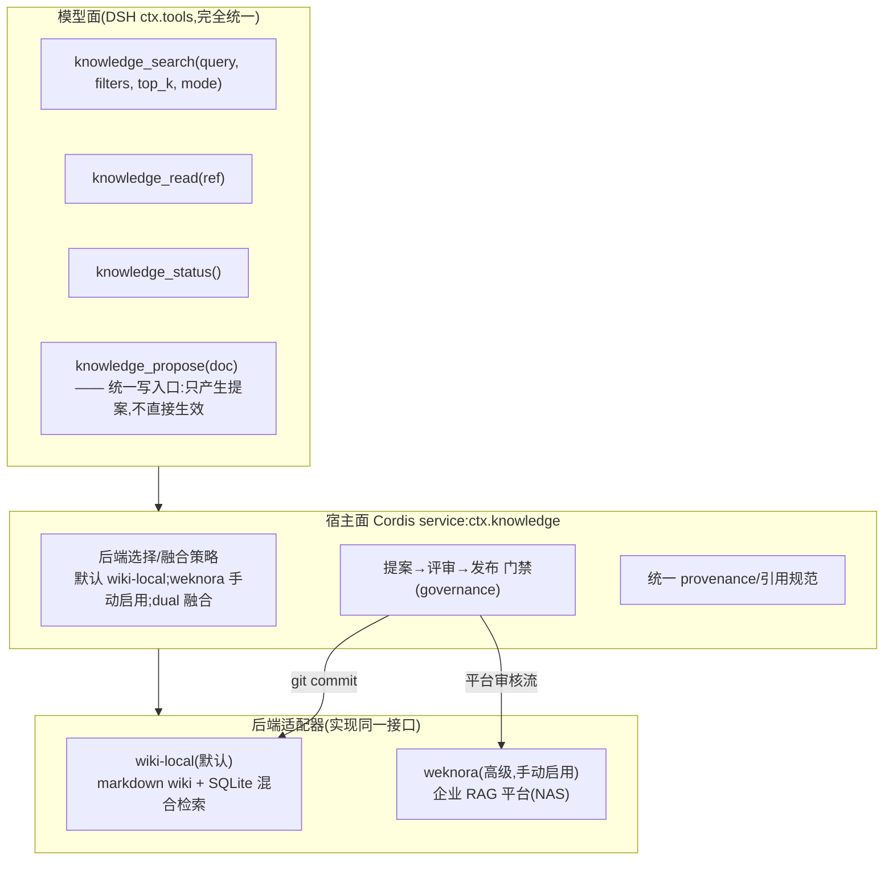

# 09 - 知识插件 dsh-knowledge:可插拔双后端设计(v0.1)

> 状态:设计稿。需求(2026-11-03 用户定):企业级知识存储**可插拔**;WeKnora 为高级进阶后端、手动启用;**默认内置本地 "LLM wiki"**(LLM/agent 自己撰写与维护的本地 wiki);专业知识检索是一个完整插件,**两个后端在 DSH 出口统一为同一规范和格式**。调研依据见文末来源。关联:[[08-基座插件体系与总体架构]](dsh-knowledge 所在的 L1 层)、[[01-RSI论文导读-质量评级与核实提醒]](知识更新与废弃的论文依据)。

## 1. 架构:一个出口,两个后端



**选型原则**:默认 `wiki-local`(零外部依赖、断网可用、agent 可写、git 版本化);WeKnora 在 settings 中手动启用(经 credentials 引用凭据,不进配置文件);两者可同时启用(`dual`:WeKnora 结果视为 authoritative 优先,wiki 结果补充,RRF 融合、同源去重)。

## 2. 统一出口规范(核心)

### 2.1 KnowledgeHit 统一 schema(模型看到的每条结果长一样,无论哪个后端)

```yaml
ref:        { doc_id, source_uri, backend }        # source_uri 可直接点开(文件路径或平台 URL)
title: ...
snippet: ...
score: 0.87
provenance:                                        # 统一溯源规范——两后端都必须填全
  origin: "《产品手册 v3.2》第4章"                  # 权威来源(原文/URL)
  created: 2026-08-01
  updated: 2026-10-12                              # 语义更新时间(非系统时间)
  valid_at: 2026-10-12                            # 生效时间(bi-temporal 简化版)
  status: active | stale | deprecated             # 废弃状态,搜索默认过滤 deprecated
  superseded_by: doc-0231                         # 被谁取代(废弃必填)
  trust: official | verified | agent_drafted      # 官方/已核验/agent 草稿
  review: reviewed | pending                      # 评审状态
```

**引用输出规范**:agent 引用知识时统一格式 `[《标题》](source_uri)(更新于 updated;状态)`——**过期信息在出口处自带警示**,这是"废弃知识不影响 agent"的第一道闸(检索层过滤 + 出口处标注,双保险)。

### 2.2 宿主面接口(Cordis service,后端适配器实现)

```ts
interface KnowledgeBackend {
  id: 'wiki-local' | 'weknora'
  capabilities: { write: boolean; deprecate: boolean; graph: boolean }
  search(q: SearchQuery): Promise<KnowledgeHit[]>      // mode: hybrid|keyword|semantic
  read(ref: DocRef): Promise<KnowledgeDoc>             // 含 changelog 段
  propose?(patch: DocPatch): Promise<ProposalId>       // 统一写入口:提案制
  deprecate?(ref: DocRef, reason: string): Promise<void>
  health(): Promise<{ ok: boolean; doc_count: number; last_sync?: Date }>
}
```

写路径统一为**提案制**:`knowledge_propose()` → governance 评审门禁(trust=agent_drafted 的页面必须过审才能转 verified;对齐 [[01-RSI论文导读-质量评级与核实提醒]] 中 AgentPoison 的记忆投毒防御——写入必须过门禁)→ 发布(wiki = git commit;WeKnora = 平台文档流程)→ 页面内 changelog 追加。

## 3. 默认后端:wiki-local 落地方案

调研结论(详见来源):成熟的"本地 LLM wiki"= **文件优先的 markdown wiki + agent 直写 + SQLite 单文件混合检索**,不自建重平台。

### 3.1 存储与组织

- **一页一文件**,目录即命名空间:`knowledge.wiki/`(git 仓库)下 `domains/`(业务域)、`entities/`(实体)、`procedures/`(流程)、`archive/`(废弃归档)+ MOC 索引页。
- frontmatter 元数据:`{title, tags, status, trust, source, created, last_verified, superseded_by}`;正文用 `[[wikilink]]` 建图;每页带 **changelog 段**(事实变更不改写历史,旧结论进 changelog)。
- **bi-temporal 简化版**(借鉴 Zep/Graphiti 思想,不引图数据库):内容时间线 = 页面 changelog;系统时间线 = git commit 历史。任何时点真值可回溯。
- 与 Obsidian/Basic Memory 格式双向兼容——人和 agent 都是一等读者,可直接用 Obsidian 浏览审阅。

### 3.2 检索栈(百-千页面的小库,核心是中文与混合)

- **SQLite 单文件双路召回 + RRF 融合**:FTS5(BM25,`trigram` 分词 + `detail=none`;**中文关键坑:默认 unicode61 分词器对中文基本失效**,短词回退 LIKE;后续可升级 jieba 自定义分词)+ sqlite-vec(暴力 KNN——此规模 ANN 收益趋近于零;本地中文嵌入 bge-m3/bge-small-zh 级小模型)。
- 零服务进程、零外部依赖(Node 原生 `node:sqlite` + sqlite-vec npm);索引文件与 wiki 同目录分发。
- 备选:LanceDB(原生 TS SDK,向量+FTS 一体,代价是 Rust 原生依赖)——若不想维护两套检索原语可换它。

### 3.3 生成与更新管线

- **冷启动**(离线 job):gpt-researcher/STORM 式管线——planner 出提纲 → 逐节生成**带引用**段落 → 落盘为页面。这两个项目定位是"生成器"而非存储层(我们只取管线思想);langchain open_deep_research 已归档(2026-08)不采用。
- **日常运营**:agent 读-改-写 + frontmatter 更新;过评审门禁的批量写入自动 git commit,人可 diff/revert(借鉴 obsidian-notes-watcher 的"人写 @提及 → agent 执行"触发范式,可选)。
- **过期待办**:agent 定期 review `last_verified` 超龄页面(status → stale);被新事实推翻的页面写 `superseded_by` 并移入 `archive/`——废弃机制与 RSI 设计的 deprecate 阶段共用此语义。

### 3.4 备选(明确排序)

1. **Basic Memory**(4.5k,AGPL-3.0,v1.0.0 2026-10-29,极活跃):MCP + markdown 知识图谱,bm_* 工具全家桶,格式与上互通——**不想自研索引层时的即插方案**(进程隔离下 AGPL 风险可控,但多一个外部运行时)。
2. **cognee**(33k,Apache-2.0):确需图谱推理(多跳实体关系)时引入,代价 Python sidecar。
3. **不采用**:Khoj(强制 Postgres+pgvector,过重)、mem0/Graphiti 整仓(会话记忆语义+图库运维,只借鉴其 bi-temporal 思想)、deepwiki-open/gpt-researcher(生成器定位)、QAnything(已停更)。

## 4. 高级后端:WeKnora 适配器

- 手动启用:settings 开关 + credentials(凭据引用);启用前 `knowledge_status()` 显示该后端 `ok:false, reason: not-configured`,模型面无感知。
- 适配映射:`search` → 平台检索 API;`read` → 文档详情;`propose` → 平台文档上传+审核流(若平台无 API 则 `capabilities.write=false`,写入一律走 wiki 层再人工导入平台);`deprecate` → 文档下架/版本更新;`health` → 平台探活。
- **知识分层不变**(与 08 号文档一致):权威共享知识 → 知识库层(本插件);经验性私有记忆 → dsh-memory(M1/M2);两者不互写。

## 5. 验收:同一套 golden cases 跑两个后端

"同一规范"不仅是接口,还包括**同一评测**:知识检索 golden cases(每行业 20-50 条:query → 期望命中文档/要点/引用)同时跑 wiki-local 与 WeKnora,用 **ai-evo 的 RAG 检索评测类型**(精确率/召回率等 6 指标)对比——后端可替换性由评测保证,而不只是接口编译通过。附加用例:废弃知识不再命中(status=deprecated 过滤)、引用 provenance 完整率、agent_drafted 未过审不出现。

## 6. 来源(关键)

- STORM/Co-STORM:[stanford-oval/storm](https://github.com/stanford-oval/storm)(31.8k,MIT;注意维护放缓)· gpt-researcher:[assafelovic/gpt-researcher](https://github.com/assafelovic/gpt-researcher)(30.4k,Apache-2.0,MCP server 现成)· deepwiki-open:[AsyncFuncAI/deepwiki-open](https://github.com/AsyncFuncAI/deepwiki-open)(18.4k,MIT)
- Basic Memory:[basicmachines-co/basic-memory](https://github.com/basicmachines-co/basic-memory)(4.5k,AGPL-3.0,v1.0.0 2026-10-29)· cognee:[topoteretes/cognee](https://github.com/topoteretes/cognee)(33k)· Khoj:[khoj-ai/khoj](https://github.com/khoj-ai/khoj)(38k,强制 pgvector)· mem0:[mem0ai/mem0](https://github.com/mem0ai/mem0)(68.3k)· Graphiti:[getzep/graphiti](https://github.com/getzep/graphiti)(32.5k,bi-temporal)
- 检索底座:[sqlite-vec](https://github.com/asg017/sqlite-vec)(8.2k,FTS5 中文 trigram 方案见 [SQLite 文档](https://sqlite.org/fts5.html))· [lancedb/lancedb](https://github.com/lancedb/lancedb)(11.8k,原生 TS SDK)· Chroma(29.6k)/Qdrant(35.4k)
- 国内快评:[MaxKB](https://github.com/1Panel-dev/MaxKB)(23.1k)/[RAGFlow](https://github.com/infiniflow/ragflow)(93.4k,重型企业级)/[QAnything](https://github.com/netease-youdao/QAnything)(停更)/[FastGPT](https://github.com/labring/FastGPT)(30k)——均为平台层,与 WeKnora 同层,印证"平台=高级后端,本地 wiki=文件优先自建层"的分层判断
