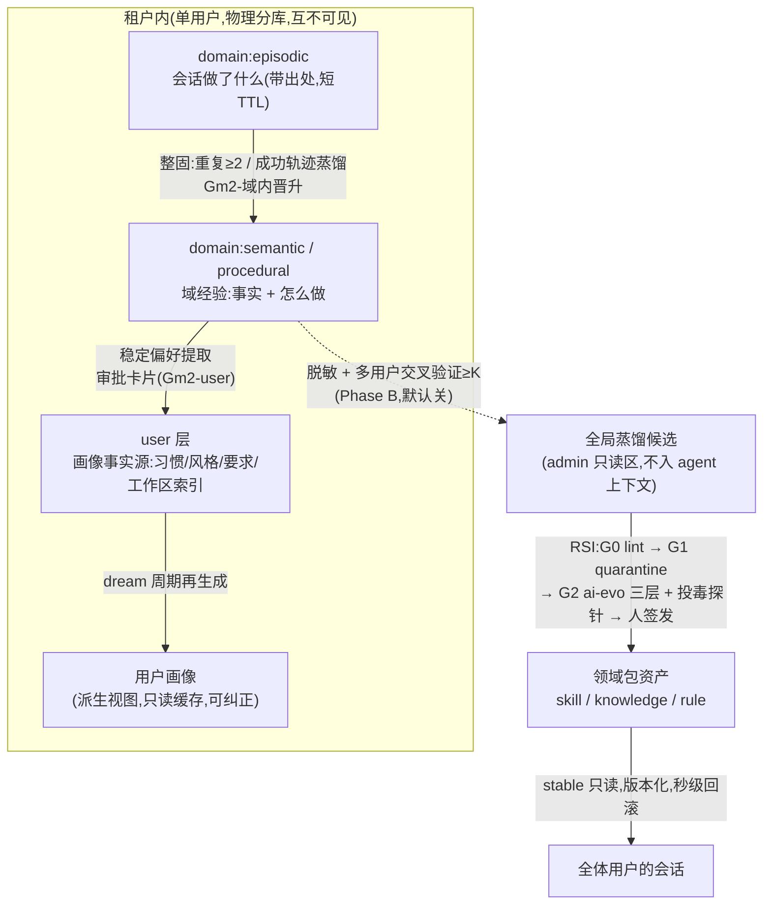

# 18 - 记忆机制定制设计:两层记忆与 RSI 上升

> 状态:设计定稿,六项开放问题已决议(2026-11-13,§13),可进入实现排期
> 日期:2026-11-13
> 上游:[[17-记忆系统调研与优化设计]](调研底座与防线)、[[09-RSI自进化机制设计]](进化铁律与对象矩阵)、[[10-dsh-evolve详细设计]](reflector/curator/门禁/账本/配置)、[[08-基座插件体系与总体架构]] §5(既有三层记忆与整固决议)
> 产品定位约束:**云端多租户 agent,用户数据隔离是铁律**(PLUGIN-AUTHORING §1.1,`packctl tenant-scan` CI 强制);数据不出内网(AGENTS.md)

---

## 0. 一句话设计

记忆 = **租户内的两层作用域(user 画像层 / domain 功能域层)× 三阶认知类型(episodic / semantic / procedural)**;写入走三通道 + 分级质量卡控,读取先过滤后排序;**"全局维度"不建全局记忆库**,而是经 RSI 蒸馏管道上升为领域包资产(skill/knowledge/rule),复用 09/10 已有的 G0–G2 门禁、三态发布与进化账本。



---

## 1. 需求 → 作用域模型

### 1.1 两层映射

| 用户需求 | 作用域 | 内容 | 认知类型 | 消费方式 |
|---|---|---|---|---|
| 第一层:用户级——工作习惯、风格、要求、工作区内容,逐渐形成用户画像 | **scope=user** | 稳定、跨域成立的用户事实 | semantic(为主) | 画像摘要常驻索引 + 按需读 |
| 第二层:功能域——用户做了什么项目的会话、什么事情、什么经验;其他会话涉及该域时可获取 | **scope=domain**(挂在用户下) | 域内会话记录与提炼出的域经验 | episodic →(整固上升)→ semantic/procedural | 当前域索引注入 + `memory_search` 按域检索 |

两层**都在单用户租户内**,不跨租户——这是与"全局维度"(§8)的本质区别。

### 1.2 与 08 §5.2 既有 scope 枚举的修订(Q1 已决议:org 云端禁用)

- 既有枚举 `project | user | org`。本设计修订为 **`user | domain`**:
  - `project` 并入 domain 的特例:**workspace 即显式域**(workspace id 直接作为 domain_key,NOTES.md 等 M1 文件不动);
  - **`org`(影响所有用户的运行时可写记忆)在云端多租户部署默认禁用**——它等价于"全局维度",必须走 §8 的 RSI 上升管道而非运行时写入面;私有化单组织部署可作为部署级配置开启(此时 org ≈ 本部署全体用户)。
- 理由:09 §3 已定 M2(org)走审批;但在多租户云产品中,任何"对所有用户生效"的运行时可写数据都是污染放大器(MPBench 单点投毒 <0.16% 检索率即可 >95% 攻击成功率,09 §0 铁律),唯一安全的全体面是**经门禁发布的只读 pack 资产**。

### 1.3 域键(domain_key)与域注册表

- domain_key 两个来源:
  1. **显式**:用户选定的 workspace/项目(登记即域,信任级高);
  2. **语义**:自由域 taxonomy(Q2 决议:不预置)——LLM 对会话内容打标候选域(如"部署"、"合同审查"、"内容发布");打标**优先归并进已注册域**,确属新域的需 **≥3 个会话命中**才允许注册(防域爆炸),domain_registry 即后续打标的候选集。
- 新表 `domain_registry`:`domain_key, label, source(workspace|taxonomy|free), session_count, memory_count, last_used_at, created_at`。
- 会话的域检测(读侧,§5):显式 workspace → 命中;否则对首条用户消息做 taxonomy 打标;多域命中取 top-2,预算内合并注入。域归属同时写入会话元数据(episodic 记录的 provenance)。

---

## 2. 数据模型(M2 增量)

现有 `memory_entity`(`packages/memory/src/entity-store.ts`):`id, subject, key, content, summary, valid_at, invalid_at, confidence, created_at, updated_at`,(subject,key) 至多一行 live,write 同键顶替,forget=真删。**该底座保留,增列不破坏既有语义**:

```sql
ALTER TABLE memory_entity ADD COLUMN kind TEXT NOT NULL DEFAULT 'semantic';
  -- episodic | semantic | procedural
ALTER TABLE memory_entity ADD COLUMN scope TEXT NOT NULL DEFAULT 'domain';
  -- user | domain(org 见 §1.2,默认禁用)
ALTER TABLE memory_entity ADD COLUMN domain_key TEXT;            -- scope=domain 时必填
ALTER TABLE memory_entity ADD COLUMN review_state TEXT NOT NULL DEFAULT 'approved';
  -- pending | approved | rejected(检索与索引注入只取 approved)
ALTER TABLE memory_entity ADD COLUMN origin_session_id TEXT;     -- 运行时写边界自动盖章(不信任模型手写)
ALTER TABLE memory_entity ADD COLUMN origin_turn_ref TEXT;
ALTER TABLE memory_entity ADD COLUMN source TEXT NOT NULL DEFAULT 'agent';
  -- explicit | agent | consolidation | compaction(compaction 来源强制 pending,17 §7.1-L3)
ALTER TABLE memory_entity ADD COLUMN last_used_at INTEGER;       -- 命中强化(MemoryBank S+=1)
ALTER TABLE memory_entity ADD COLUMN use_count INTEGER NOT NULL DEFAULT 0;
```

- **subject 编码规范化**(工具层强约束,兼容既有数据):`user`(用户画像层)/ `domain:<domain_key>`。`memory_search(subject?)` 过滤天然可用。
- episodic 落库形态:每会话(或每域会话段)一行,`key = session-<sessionId>`,content=压缩摘要,`confidence` 初始低(0.5),TTL 默认 30 天(整固前淘汰或上升)。
- 画像为**派生文件**不入表:`$DSH_HOME/workspaces/<账号>/.eterna/portrait.md`(分节 Markdown + frontmatter 记版本/生成时间/来源记忆 id 列表),见 §6。

---

## 3. 写入管线:三通道 × 分级质量卡控

### 3.1 三通道(实例化 17 §7.2,对齐 08 §5.4 / 10 §1 既有审批决议)

| 通道 | 触发 | 落点 | review_state | 依据 |
|---|---|---|---|---|
| 显式 | 用户说"记住/忘记 X" | 对应 scope | **直接 approved** | 社区最可信时机(17 §4.2) |
| hot | agent 会话中自主判断 | `domain:episodic` | approved(静默) | 08 §5.4 "project 静默写入";10 §1 autoPromoteScopes |
| | | `domain:semantic/procedural`、`user` | **pending → interact 审批卡片**("从本次会话学到:…是否记住?") | 08 §5.4 "user/org 走审批";10 §1 requireHumanApproval(memory.user) |
| cold | 整固 job(§6,reflector 触发源) | 各 kind | 按目标层同上;`source=compaction` 强制 pending | 投毒 C3 通道(17 §3.3-2) |

工程纪律(全部有 ZCode 源码先例,17 §2.4):单 running + latest-pending 合并、调度边界冻结快照(Rewind 不取消)、cursor 语义(success/no-op/skip 推进)、**单轮跳过逃生口**(本 turn 涉及一次性凭据/敏感操作 → `memoryExtraction:"skip"` 同款,对齐本仓凭据护栏)、session close 先 abort 后有界 drain。

### 3.2 质量卡控(记忆门禁 Gm,按风险缩放 09 的 G0–G2)

| 闸 | 时机 | 内容 | 自动化 |
|---|---|---|---|
| **Gm0 结构闸** | 每次写入同步 | schema/单条长度上限/单域条数上限/**PII fail-closed(既有)**/同域同 kind 相似度查重(命中→强制 UPDATE 路径,禁止新建重复)/NOOP 决策 | 全自动 |
| **Gm1 一致性闸** | 整固 job 内异步 | 矛盾检测:新旧矛盾→新写 + **旧条目打 invalid_at(软失效,bi-temporal 既有能力)**;与 AGENTS.md/docs 冲突→**CONFLICT-FLAG**(标"待核对"上报,不静默改写指令文件,ZCode Dream 对账模式);相对日期转绝对;来源分级 | 全自动 |
| **Gm2-域内晋升** | episodic→semantic/procedural | 同一(模式,根因)重复 ≥2(复用 10 §1 repeatThreshold)+ curator 起草 + reviewer 复核 + **人审抽样(初始 100%,稳定后降)** | 半自动 |
| **Gm2-user 晋升** | domain→user | 审批卡片逐条(初始全审) | 人审 |
| **Gm2-global 晋升** | →全局资产 | **RSI 全门禁**:G0 lint / G1 quarantine 试跑 / G2 ai-evo 三层 + 投毒探针 + **跨用户交叉验证 ≥K(建议 5 个独立用户同一模式)** + SME 人签发 | L4 人签发 |

- 每次写入/晋升/淘汰在 `evolve_ledger` 记 `kind=memory` 一条(触发信号→diff→门禁结果→生效版本),满足 09 §0 "记忆写入需独立专项审计" 铁律。
- 检索注入统一过滤:`review_state=approved AND invalid_at IS NULL`——pending/rejected/过期内容物理留档、逻辑不可见(09 §5 "不影响 agent" 性质)。

---

## 4. 读取管线

### 4.1 索引注入(会话启动,`memory:index` section 升级)

```
总预算 ≤500 token(既有),内部分配:
  ① 画像摘要            ≤150 token(user 层派生视图,§6)
  ② 当前域 live 索引     ≤250 token(domain 层 key+summary,confidence↓新近↓)
  ③ 逃生提示            footer:"跨域或全文检索用 memory_search"(既有模式)
```

- 多域命中(§1.3)时 top-2 域合并,预算不足按置信截断;**跨域内容不主动注入**,须显式 `memory_search`(scope 过滤:当前域优先,再 user;跨域检索返回带域标注)。
- 召回正文带前缀 "Retrieved for possible relevance — use only if it actually applies" + **时效警告**(`last_used_at`/`updated_at` 超 N 天附"该记忆 N 天未验证",ZCode semantic-recall 同款)。

### 4.2 排序与命中强化

- 检索分 = `confidence × 2^(−age/halfLife) + λ·命中强化(use_count 归一)`;halfLife=90 天(10 §1 confidenceHalfLifeDays 直接复用)。
- 每次被 `memory_search` 命中且内容进入最终回复 → `use_count+1, last_used_at=now`(MemoryBank 越用越牢;判定"被采纳"用工具调用后无立即否定 + 下一轮引用,粗粒度即可)。

---

## 5. 用户画像机制(第一层的"逐渐可见画像")

- **画像 = 派生视图,不是第二事实源**:user 层单条 semantic 记忆是权威;画像由整固 job 聚合生成为 `portrait.md`(分节:工作习惯 / 风格偏好 / 协作要求 / 工作区索引——即用户需求的"工作区内容"),frontmatter 记 `version, generated_at, source_memory_ids[]`(可追溯到条)。
- 生成时机:整固 job 周期任务(如每日);user 层有变更时增量刷新。
- **纠正回路**:用户在面板看画像 → 点某段"不对/修改" → 落一条 user 层记忆(显式通道,approved)+ 触发再生成——纠画像必须落到事实源,不允许只改视图(否则下次再生成就回弹,ChatGPT 假记忆删不掉的教训,17 §3.3-6)。
- 注入只读画像摘要;正文(含来源记忆列表)按需。

---

## 6. Dream / 整固 job:reflector 触发源实例化

08 §5.4 已定"整固 job 自 09 起归入 dsh-evolve reflector 触发源";本节实例化(双频次,对齐 10 §3):

| 频次 | 触发 | 动作 | 模型 |
|---|---|---|---|
| **轻量(会话尾)** | session end 钩子 | 域打标落库 + episodic 摘要落域 + 信号进 `evolve_signal`(MAST 打标) | reflector(默认 Flash) |
| **重量(周期)** | schedule(如每日) | 四阶段 Dream:① Orient(盘点 user 层+各域);② Gather(读 episodic 与漂移信号,**窄读不全量**);③ Consolidate(episodic→域经验晋升[Gm2-域内]、稳定偏好→user 层提案[Gm2-user]、矛盾对账[Gm1]、相对日期转绝对、删除被证伪事实);④ Prune(索引裁剪、episodic TTL 淘汰、半衰期降权、**画像再生成**) | reflector + curator + reviewer |

- 09 §1 元共识落地:写入门槛 = "重复犯过的错/重复出现的偏好"(一次性意外不沉淀);**先归因再写入**(环境坏→建议重启,不产生记忆提案,Devin 口诀);能降级为确定性规则的偏好(如"提交前跑 X")建议转 rule/skill delta 而非记忆(走 curator 其他通道)。
- 废弃对齐 09 §5 / 10 §7:软失效优先(close 窗口);物理删除仅用户显式 forget(保住 forget=真删卖点);淘汰也是 effect,可逆可审计。

---

## 7. 记忆上升阶梯(探索 2 的落地总图)

| 层级跃迁 | 触发信号 | 门禁 | 自动化(对齐 09 §3) | 失败回退 |
|---|---|---|---|---|
| M0 会话内 → domain:episodic | 会话尾整固 | Gm0 | **L1 全自动** | TTL 自然过期 |
| episodic → domain:semantic/procedural | 重复 ≥2 / 成功轨迹蒸馏 | Gm0+Gm1+Gm2-域内 | **L2 半自动(人审抽样)** | 不晋升,自然淘汰 |
| domain → user(画像层) | 跨域重复出现的稳定偏好 | Gm2-user 审批卡片 | **L2 人审** | 拒绝即 rejected(不可见) |
| domain/user →(脱敏)→ 全局候选 | 多用户交叉验证 ≥K | 脱敏校验 + admin 只读区 | **L3 受控**(§8) | 候选废弃 |
| 全局候选 → 领域包资产 | curator 起 delta | **G0–G2 + 投毒探针 + 人签发** | **L4 人签发** | git revert 秒级回滚 |

- 09 §3 进化对象矩阵的 memory 行据此细化为上表前三行 + 全局两行;`autoPromoteScopes` 语义更新为 `[memory.domain.episodic]`。
- **防"越学越傻"**(09 §7 对记忆维度的实例化):蒸馏源 = 成功轨迹 ∪ 真实轨迹锚定;失败轨迹只进分析不进库;晋升都过 reviewer 异构复核;账本全记录。

---

## 8. 全局蒸馏(探索 1)可行性评估

### 结论

**可行,但形态必须是"RSI 蒸馏管道 → 领域包资产",不是"全局记忆库";分三阶段;默认关闭,部署级显式授权开启。**

不建全局记忆库的理由:(a) 任何全体用户可读的运行时可写存储都是污染放大器(单租户投毒 → 全体用户,MPBench 自我强化机理);(b) 多租户隔离铁律下,跨用户数据面只有"经 CI(tenant-scan)+人审+版本化的 pack 产物"是既定合法通道;(c) "去掉用户特色的知识"本质是 skill/knowledge/rule(delta 三类),RSI 管道现成。

### 三阶段

| 阶段 | 形态 | 内容 | 门禁 |
|---|---|---|---|
| **Phase A:只读报告** | admin 周期 job | 跨用户聚合:同一失败模式/同一偏好的**多用户计数报告**(≥K 用户才列出),零 agent 上下文影响 | admin 可见即可;零风险 |
| **Phase B:候选 delta** | curator | 从报告起草 pack delta(skill/knowledge/rule),**脱敏后**进 pack 仓库 quarantine | 脱敏校验 + G0–G2 + 投毒探针 + 跨用户 ≥K + SME 人签发 |
| **Phase C:灰度发布** | rainbow 切流 | stable 后按领域包逐步放量,账本回填效果(T+7d 对比) | 既有发布纪律 |

### 前置条件与风险

| 风险 | 缓解 |
|---|---|
| 跨租户投毒放大 | 交叉验证 ≥K 独立用户;投毒探针必含;候选先 quarantine;回滚秒级 |
| "去用户特色"不彻底(写作风格/路径/项目名残留) | 自动脱敏(PII 过滤器复用+实体替换)+ packctl lint 增残留检测规则(路径/人名/租户标识)+ 人审 |
| 隐私合规 | `distill.enabled` 默认 false;开启需管理员显式授权与隐私声明;用户层可在设置中退出自己的记忆参与蒸馏(opt-out) |
| 冷启动无统计意义 | 用户量 < 阈值(如 20 活跃)时 Phase A 报告标注"样本不足",不产生候选 |
| 中间产物泄漏 | 蒸馏 job 以 admin 身份只读快照各用户库;中间产物进隔离目录(不经任何 agent 上下文);候选入库即走 pack 通道 |

---

## 9. 多租户隔离落实(硬约束清单)

1. **物理分库**:`memory.sqlite3` 与 `portrait.md` 必须位于用户 workspace 派生路径(`$DSH_HOME/workspaces/<账号>/...`);`packctl tenant-scan` 增断言规则(禁 cwd 逃逸/绝对路径)。
2. **检索先过滤后排序**:scope 过滤在语义排序之前(Zep scoped retrieval);跨域/跨用户检索无合法路径——跨用户只有 pack 资产只读面。
3. **全局层物理位置**:只存在于 pack 仓库(git,三态版本),不在任何记忆库;tenant-scan 扫 pack 无用户残留。
4. **指令隔离**:召回记忆以低权限上下文注入,不与红线 persona/system 指令混排(17 §7.3;渲染位置随 P1 审查)。
5. PII fail-closed 全写入路径(既有);`source=compaction` 强制待审(既有 compaction 包的摘要产物参与整固时)。

---

## 10. 前端交互增量(在 17 §7.5 三件套之上)

| 位置 | 形态 | slot |
|---|---|---|
| 记忆管理面板顶部 | **画像卡片**:当前画像摘要分节展示 + "纠正此项"(落 user 记忆)+ "重新生成";来源记忆可点开 | `main`(panel 扩展) |
| 面板主体 | **域浏览**:按域分组(域名/条数/最近使用/待审数),域详情列表(kind 标签:经验/事实/记录);user 层独立分区 | `main` |
| 会话内 | **域识别提示 chip**:"本次识别为域:部署",可切换/纠正(纠正=写 domain_registry 元数据)(Q6 决议:进会话 UI) | `conversation.input.right`(M-M3 交付) |
| 会话内 | 晋升审批卡片复用 08 §5.4 既有形态("从本次会话学到:…是否记住?") | `conversation.approval.card` |
| 会话内 | "本回合用到 N 条记忆"Sources 行(17 §7.5-C) | `conversation.chat.turnTail` |
| admin | 全局蒸馏报告页(Phase A 只读;Phase B 起含候选 delta 与门禁报告链接) | `plugins.tab` |
| 设置分区 | 17 §7.5-B 基础上增:画像开关、域识别开关、**"我的记忆参与全局蒸馏"退出开关**(默认随部署) | `settings.section` |

---

## 11. 与既有文档的 delta(评审时按此核对)

| 文档 | 修订点 |
|---|---|
| 08 §5.2 | scope 枚举 `project|user|org` → `user|domain`(project=显式域特例);**org 云端禁用(Q1 已决议**,私有化部署可配置开) |
| 08 §5.4 | 静默写入范围收窄为 `domain:episodic`;域语义/程序性记忆与 user 层走审批卡片;整固细化为本设计 §6 双频次 |
| 10 §1 | 配置增 `memory:` 节(portrait/domain/promotion/distill);`autoPromoteScopes → [memory.domain.episodic]` |
| 09 §3 | memory 行细化为 §7 阶梯五行;新增"全局蒸馏"进化对象(L3/L4) |
| 17 §7 | 本设计是其在本产品定位下的实例化;17 的 P1–P4 与 §12 里程碑对齐 |

dsh-evolve 配置增补(示意,接 10 §1):

```yaml
dsh-evolve:
  memory:
    portrait:  { enabled: true, regenerateCron: "0 4 * * *", maxTokens: 150 }
    domain:    { taxonomy: free, minSessionsForNewDomain: 3, indexTokens: 250 }
    episodic:  { ttlDays: 30, perDomainLimit: 200 }
    promotion: { userPromotionSampleRate: 1.0, crossUserMinUsers: 5 }   # Q3:初始全审,画像稳定后降采样率
    distill:   { enabled: false, phase: A, minActiveUsers: 20 }
```

---

## 12. 落地里程碑(对齐 10 §9 M-E* 与 17 §8)

| 阶段 | 内容 | 依赖 | 预估 |
|---|---|---|---|
| **M-M1**(≈17 P1) | M2 增列 + domain_registry + 检索过滤/排序/时效警告 + 画像 v0(手动触发生成)+ tenant-scan 断言 | 无 | 2 周 |
| **M-M2**(≈17 P2) | 三通道写入 + Gm0/Gm1 + 审批卡片 + 单轮跳过逃生口 + cursor/调度纪律 | schedule/jobs seam(既有) | 2–3 周 |
| **M-M3** | 双频次整固 job(轻量会话尾 + 重量 Dream 四阶段)+ 域内晋升 + 画像周期再生成 + 衰减淘汰 + 前端三件套 + 画像卡 + 域浏览 + **域识别 chip(Q6)**,域打标准确率纳入验收 | M-M1/M-M2;reflector 配置(10 §1) | 2 周 |
| **M-M4**(探索 1) | Phase A 蒸馏报告(admin);Phase B 候选 delta 走 G0–G2 | **ai-evo 连通(M-E0,baseUrl/Key 待定)**;开关决议已定(Q4:默认 false,管理员授权链) | Phase A 1 周;B 随 RSI 管道 |

---

## 13. 决议记录(2026-11-13,用户拍板)

| # | 议题 | 决议 | 执行要点 |
|---|---|---|---|
| Q1 | org scope 云端禁用? | **禁用** | 跨用户共享一律走 RSI 上升(§8);私有化部署可配置开启 |
| Q2 | 域 taxonomy 来源 | **自由域**:不预置 taxonomy,LLM 打标,新域 ≥3 会话命中才注册 | 打标先归并已有域,确属新域才计数(§1.3 已更新);归并质量是 M-M3 验收指标之一 |
| Q3 | domain→user 晋升审级 | **初始审批卡片全审;画像稳定后转抽样(配置化)** | 配置 `promotion.userPromotionSampleRate`(初始 1.0);采样率下调需以画像纠正率下降为前置证据 |
| Q4 | 全局蒸馏开关与授权链 | **按建议执行** | `distill.enabled` 默认 false;开启需管理员授权 + 隐私声明;设置分区提供用户级 opt-out(§10) |
| Q5 | episodic TTL/每域上限 | **按建议执行** | `episodic.ttlDays=30, perDomainLimit=200` 起步;整固后按域热度自适应(远期) |
| Q6 | 域识别 chip 是否进会话 UI | **进会话 UI** | M-M3 交付,`conversation.input.right` slot;可切换/纠正;打标准确率纳入 M-M3 验收 |
