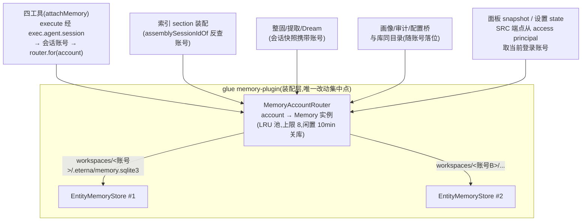

# 23 - 记忆多租户分库设计(专项:云端多用户数据隔离)

> 状态:方案探索与设计稿,待评审(M-M1~M-M3 已落地后的部署级专项)
> 日期:2026-11-16
> 上游:[[18-记忆机制定制设计-两层记忆与RSI上升]]、[[19-记忆系统开发文档-M-M1至M-M3]]、[[19-记忆系统开发进度]] §7-2 增量、docs/PLUGIN-AUTHORING.md §1.1(T1 铁律)
> 触发:2026-11-15 隔离容器 GUI 验收实跑发现——web 多用户下记忆库跟随**宿主进程 cwd**(`/data/.eterna/`),种子放入 `workspaces/Mr.Ma/` 下面板不可见;与多租户隔离铁律冲突,立项专项。

---

## 0. 一句话结论

现状是**单库全局共享**(宿主 cwd 单一 sqlite),不满足 T1「用户数据必须派生自 `$DSH_HOME/workspaces/<账号>/`」;推荐 **方案 C(per-account store 池)**:数据物理落各账号 workspace 目录,glue 层引入 **MemoryAccountRouter**(账号→Memory 实例,LRU 连接池),对外仍是单一 `@eterna/memory` 服务面,四工具/索引/整固按会话账号路由,面板/设置数据面按登录账号路由;历史全局库按 `origin_session_id` 归账迁移。

## 1. 现状核实(2026-11-15/16 实测)

| 面 | 现状 | 证据 |
|---|---|---|
| M2 库路径 | `dbPath = config.dbPath ?? join(cwd, '.eterna/memory.sqlite3')`——宿主进程 cwd,web 容器内=/data(全局) | `packages/glue/src/plugins/memory-plugin.ts`(defineMemoryPlugin 缺省) |
| M1 notes | `workspaceDir = config.notesDir ?? join(cwd, 'NOTES')`——同样全局 | 同上 |
| 画像/审计/配置桥 | 与库同目录(portrait.md / memory-audit.jsonl / memory.config.json)——全局 | tenant.ts fail-closed 锚(dbPath 派生) |
| 面板数据面 | snapshot/admin-plugin 只读打开**同一全局库**(join(cwd,'.eterna',...)) | `packages/panel/src/snapshot.ts:378` |
| GUI 实证 | 种子放 `/data/workspaces/Mr.Ma/.eterna/` 面板不显示;放 `/data/.eterna/` 全部显示 | 2026-11-15 验收记录(19-progress §7-2) |
| 铁律冲突 | T1:持久化必须派生自 `$DSH_HOME/workspaces/<账号>/`(`packctl tenant-scan` CI 强制) | PLUGIN-AUTHORING §1.1 |
| tenant-scan 现状 | 只扫**路径派生面**(dbPath/portrait 必须落在 workspace 派生目录或声明锚)——当前缺省布局本身就是违例形态的邻域(全局路径被 glue 显式锚豁免) | `tools/packctl/src/tenant.ts` |

**一个缓解性事实**:会话本身在 dsh session 层是按账号隔离的(工作区树/会话记录),且 M2 行有 `origin_session_id` 溯源列(T2 盖章)——但这是**审计便利**,不是隔离:任何账号的 agent 都能 `memory_search` 检索到全局库中其他账号的记忆(四工具无账号过滤面)。**这就是本专项要消除的泄露面**。

## 2. 方案对比

| 方案 | 形态 | 隔离强度 | 改动面 | 评估 |
|---|---|---|---|---|
| **A 行级 account 列** | 全局单库加 `account_id` 列,所有读写 SQL 强制按当前账号过滤 | 弱(靠查询纪律;一处漏过滤即跨账号泄露;tenant-scan 无法覆盖 SQL 面) | 小 | **否**——隔离靠纪律是反模式,与「隔离是铁律」的仓规精神相反 |
| **B 视图过滤(仅面板)** | 库不动,面板按账号过滤展示 | 最弱(agent 侧仍全局) | 最小 | **否**——只解决"看不见",不解决"读得到" |
| **C per-account store 池(推荐)** | 每账号独立 sqlite(落 `workspaces/<账号>/.eterna/`),glue 引入 MemoryAccountRouter(LRU 连接池,按账号懒开);对外仍单服务面 | 强(物理分库;T1 天然达标;单账号库被攻破不影响他人) | 中(路由 seam 集中在 glue;各消费面取实例时传账号) | **推荐**——与既有双时态/门禁/整固逻辑零冲突(每个实例就是今天这个 EntityMemoryStore) |
| **D 会话级内存态(不落盘跨会话)** | 放弃跨会话记忆 | — | — | **否**——跨会话记忆是产品核心卖点 |

## 3. 推荐方案 C 的设计

### 3.1 路由面(唯一新增大件)

- **账号解析**(单一真值):会话侧 `exec.agent?.session` → dsh 会话所属工作区 → access store 的账号;面板/SRC 侧从 mux principal(access 守卫后)取。两路解析收敛为一个 `accountOf()` helper,glue 唯一实现。
- **Memory 实例形状不变**:`createMemory()` 每账号一份(PII 守卫/undo/四操作逻辑全复用);Router 实现 `Memory` 接口做**代理门面**(方法签名增可选 `account` 提示参数或内部 session 绑定——见 3.4)。
- **fail-closed**:账号解析失败(匿名/系统会话)→ 不落库(工具返回结构化错误),绝不退回全局库——宁可丢一条记忆,不可跨账号写。

### 3.2 各消费面的归属规则(需要拍板的边缘)

| 消费面 | 归账规则 |
|---|---|
| 会话内四工具/索引/chip | 会话账号(显式) |
| 轻量整固(会话尾) | 会话账号 |
| **重量 Dream(周期,无会话上下文)** | 遍历**活跃账号集**(有会话记录的账号)逐账号跑;单账号库内自洽 |
| episodic `session-<id>` 记录 | 会话账号(天然) |
| `domain_registry` | **每账号一份**(域是用户视角资产;Q2 自由域生长在个人库) |
| 画像 portrait.md / 审计账本 / overrides | 随账号库同目录 |
| 面板「记忆指标」 | 当前登录账号 |

### 3.3 历史数据迁移

- 全局库(`/data/.eterna/memory.sqlite3`)存量行按 `origin_session_id` → session 归属账号(会话记录在 `$DSH_HOME/storages`/sessions 面可查)→ 写入对应账号新库;**无法归属的行**(origin 缺失/会话已清)留在全局库只读归档(不进任何账号路由)。
- 迁移脚本 `packages/memory/scripts/migrate-to-per-account.mjs`(一次性,dry-run 默认,`--apply` 显式),跑在部署窗口;迁移前卷快照。

### 3.4 需要核实的 seam(实施前置 Spike,对齐 19 号 §8 方法)

| # | 核实项 | 影响 |
|---|---|---|
| TS-1 | 会话→账号的解析面(dsh session/access store 形状;整固/Dream 后台任务能否拿到) | Router 键 |
| TS-2 | attachMemory 的索引 text provider 能否拿到装配上下文的账号(assemblySessionIdOf 先例已通 T10) | 索引路由 |
| TS-3 | SRC 端点(unary owner peer)的账号读取(access principal 形状) | 面板/设置路由 |
| TS-4 | sqlite 多实例并发的 WAL 上限(每账号一库,天然分文件,无单库并发压力——预期无风险) | 池参数 |

### 3.5 里程碑

| 阶段 | 内容 | 依赖 |
|---|---|---|
| **M-T1 路由面** | Router + 账号解析 + 四工具/索引路由;单账号 E2E(两账号互不可见,19 号 §9-3 的验收项在此闭环) | TS-1/TS-2 |
| **M-T2 管理面** | 面板/设置/整固/Dream 按账号路由 + 指标区按账号 | TS-3;M-T1 |
| **M-T3 迁移** | 迁移脚本 + 部署窗口执行 + tenant-scan 断言升级(全局库路径不再豁免) | M-T1/M-T2 |

### 3.6 与既有决议的关系

- 18 号 §1.2「org scope 云端禁用」不受影响(仍禁;跨用户共享唯一通道是 RSI→pack);
- 17 号 §9「物理分库」清单由本设计落为实施项;
- `packctl tenant-scan` 升级为「全局记忆路径零豁免」(M-T3 后 glue 缺省布局改为账号派生,现锚点反转成违例规则)。

## 4. 开放问题(评审拍板)

| # | 问题 | 建议 |
|---|---|---|
| Q1 | 账号池上限与闲置关闭参数 | 8 实例/10 分钟(单账号库轻,内存占用可控;实测后调) |
| Q2 | Dream 遍历全部活跃账号的成本上界 | 账号数 >20 时分片(每日 1/7 轮转),防止周期任务线性膨胀 |
| Q3 | workspace 目录与账号的映射键(access 账号 id vs 目录名) | access 账号 id(稳定),目录名仅展示 |
| Q4 | 迁移期间新旧双写窗口 | 不双写——部署窗口一次性迁移+切换(卷快照可回滚),避免双写一致性复杂度 |
